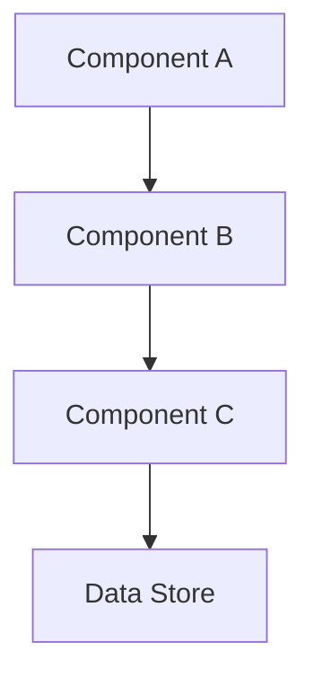

# Architecture: <project or feature> — version <version>

Use only relevant sections; a small feature can be one paragraph and criteria.
Replace bracketed fields before approval.

## Outcome and scope

Current/desired behavior, users, included/excluded work.

## Requirements and assumptions

Functional acceptance, relevant nonfunctional budgets, constraints, integrations,
open questions, explicitly marked reversible assumptions.

## Design

Affected boundaries, interfaces, data/dependency flow, technology and alternatives.
Diagram only if helpful; reference significant ADRs.

## Research Results

| Task ID | Role | Key Findings | Architecture Impact |
|---------|------|--------------|---------------------|
| <research-001> | System Architecture | 
 | <impact> |
| <research-002> | Domain Intelligence | 
 | <impact> |

## Risks and recovery

Applicable auth/trust, sensitive data, failures, compatibility, migration/rollback,
performance, reliability.

## Milestones

| ID | Deliverable | Acceptance | Required checks | Dependencies |
| --- | --- | --- | --- | --- |
| <id> | <scope> | <observable behavior> | <commands or inspection> | <prerequisites> |

## Task Contracts (Reference)

| Task ID | Role | Goal | Review By | Required Checks |
|---------|------|------|-----------|-----------------|
| <impl-001> | Backend Specialist | <goal> | <critic-001> | unit-tests, contract-test |
| <critic-001> | Independent Critic | Verify impl-001 | — | pair-review |

## Project View

Generated: `validate.py project-view ROOT generate`
Status: <Entwurf | Geprüft | Genehmigt | Umgesetzt>

## Approval requested

Exact version/milestone, assumptions, risks, unresolved decisions. Save final
proposal before computing its digest and asking.