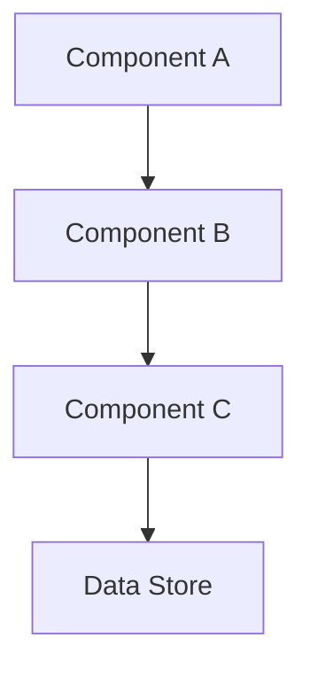

# Project Overview: <project_id> — <status>

**Status**: <Entwurf | Geprüft | Genehmigt | Umgesetzt>
**Architecture Version**: <arch_version>
**Brief Version**: <brief_version>
**Generated**: <timestamp>

---

## Goal & Key Functions

**Primary Goal**: <goal>
**Key Functions**:
- <function 1>
- <function 2>

---

## Component & Data Flow Diagram

**Legend**:
- Boxes = Components/Services
- Arrows = Data/Control Flow
- Dashed = Async/Event
- Red = Security Boundary

**Text Alternative**:
<Component A> calls <Component B> which calls <Component C> which reads/writes <Data Store>.
Security boundary between <Component B> and <Component C>.

---

## Milestones & Dependencies

| ID | Deliverable | Acceptance | Required Checks | Dependencies | Status |
|----|-------------|------------|-----------------|--------------|--------|
| M1 | <deliverable> | <criteria> | <checks> | <deps> | <status> |
| M2 | <deliverable> | <criteria> | <checks> | M1 | <status> |

---

## Roles, Tasks & Review Assignment

| Task ID | Role | Goal | Review By | Status |
|---------|------|------|-----------|--------|
| impl-001 | Backend Specialist | <goal> | critic-001 | <status> |
| critic-001 | Independent Critic | Verify impl-001 | — | <status> |
| integration-001 | Integration Engineer | Integrate M1 | Architecture Lead | <status> |

---

## Architecture Research

| Task ID | Role | Status | Agent | Model | Confidence |
|---------|------|--------|-------|-------|------------|
<research-row>

---

## Agent Runtime Evidence

| Task ID | Native Agent | Model | Session ID | Execution Mode |
|---------|--------------|-------|------------|----------------|
<runtime-row>

Execution mode `native` means a real harness agent ran in its own session.
`fixture` means a deterministic test double ran; such a run is never reported
as an independent review.

---

## Skills, Installation & Models

| Skill | Version | Install Status | Consent | Used By |
|-------|---------|----------------|---------|---------|
| <skill-id> | <rev> | <not_installed | installed | approved> | <granted | pending> | <task-ids> |

**Model Profiles**:
- Lead / Architecture Lead: High (strongest authorized)
- Implementers: Medium
- Critics: Medium/High (per risk)
- Routine: Low

**Profile**: <profile-note>

---

## Risks, Open Decisions & Mandatory Checks

**Key Risks**:
- <risk 1>
- <risk 2>

**Open Decisions**:
- <decision 1>
- <decision 2>

**Mandatory Checks** (from milestone.required_checks):
- <check 1>
- <check 2>

---

## Next Action

> **Soll ich den ersten beschriebenen Meilenstein (M1) mit diesem Plan, Team, Skills und Prüfpolitik starten?**

- [ ] Ja, M1 starten
- [ ] Nein, Änderungen nötig
- [ ] Skills/Installation separat freigeben