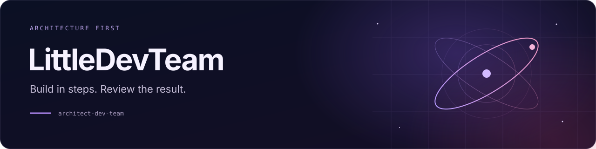
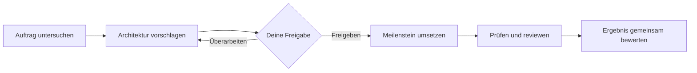

<p align="center">
  
</p>

<p align="center">
  <a href="https://github.com/YoungJibbit95/ldt-skill/actions/workflows/validate.yml"></a>
  <a href="https://github.com/YoungJibbit95/ldt-skill/actions/workflows/website.yml"></a>
  <a href="https://youngjibbit95.github.io/ldt-skill/de/docs/install/"></a>
  <a href="https://youngjibbit95.github.io/ldt-skill/en/"></a>
  <a href="LICENSE"></a>
</p>


<p align="center">
  <a href="https://youngjibbit95.github.io/ldt-skill/en/">Website</a> ·
  <a href="https://youngjibbit95.github.io/ldt-skill/en/docs/install/">Installation</a> ·
  <a href="https://youngjibbit95.github.io/ldt-skill/de/docs/guide/">Guide</a> ·
  <a href="https://youngjibbit95.github.io/ldt-skill/de/demo/">Demo</a> ·
  <a href="https://youngjibbit95.github.io/ldt-skill/en/">English docs</a> ·
  <a href="https://github.com/youngjibbit95/ldt-skill/releases">Releases</a> ·
  <a href="https://github.com/youngjibbit95/ldt-skill/issues">Report Bug</a>
</p>

<p align="center">
  <a href="https://github.com/youngjibbit95/ldt-skill/stargazers">
    
  </a>
  <a href="https://github.com/youngjibbit95/ldt-skill/network/members">
    
  </a>
  <a href="https://github.com/youngjibbit95/ldt-skill/issues">
    
  </a>
  <a href="https://github.com/youngjibbit95/ldt-skill/releases">
    
  </a>
</p>

<p align="center">
  
  
  
  
</p>

<p align="center">
  <a href="https://github.com/youngjibbit95/ldt-skill">
    
  </a>
  <a href="https://youngjibbit95.github.io/ldt-skill/de/demo/">
    
  </a>
</p>

# LittleDevTeam

A skill for Codex that turns an idea into an architecture proposal and a verified milestone. You approve the plan and review the result.

## Quickstart

Open your project in Codex and paste this prompt:

```text
Install LittleDevTeam from https://github.com/YoungJibbit95/ldt-skill into this project. Use the latest stable version, verify the installation, then start project planning with $architect-dev-team. Ask me what I want to build.
```

**No stable release is available as of 20 October 2026.** The agent must check [Releases](https://github.com/YoungJibbit95/ldt-skill/releases), offer a verified development revision if needed, and record its exact commit. Existing installations must be compared before an update. Python 3.10+ is required for package verification.

[Manual installation and troubleshooting](https://youngjibbit95.github.io/ldt-skill/en/docs/install/) · [Features](https://youngjibbit95.github.io/ldt-skill/en/docs/#how-the-skill-works) · [Workflow](https://youngjibbit95.github.io/ldt-skill/en/docs/workflow/) · [Examples](https://youngjibbit95.github.io/ldt-skill/en/docs/guide/)

The published skill supports project discovery, architecture proposals, optional specialist delegation, verification, and saved context. Structured intake helpers and the newer team/runtime workflows remain unpublished; see the [capability and release proposal](docs/onboarding-skill-release-proposal.md). Package validation does not prove Codex discovery.


## 🪐 Was ist LittleDevTeam?

LittleDevTeam hilft dir, größere Entwicklungsaufgaben mit einem Coding-Agenten in prüfbare Schritte aufzuteilen. Du klärst Anforderungen, bewertest einen Architekturvorschlag und gibst einen konkreten Meilenstein frei. Nach der Umsetzung prüfst du das Ergebnis, bevor die nächste Iteration beginnt.

Der Skill heißt technisch `architect-dev-team`. Seine Anweisungen und Python-Prüfwerkzeuge liegen vollständig in diesem Repository.

| Was du brauchst | Was der Skill dafür vorsieht |
| --- | --- |
| Einen nachvollziehbaren Plan | Versionierte Architekturvorschläge und begrenzte Meilensteine |
| Übersicht nach einer Unterbrechung | Lokale Aufzeichnungen zu Umfang, Entscheidungen und Prüfungen |
| Belege für ein Ergebnis | Prüfbefehle, Quellcode-Snapshots und Review mit benannten Grenzen |
| Unterstützung bei größeren Aufgaben | Begrenzte Agentenaufträge, sofern die Umgebung sie erlaubt und unterstützt |


## 🧭 Erst im Beispiel-Repository ausprobieren

Du brauchst Git und eine Coding-Agent-Umgebung mit Skill-Unterstützung. Für die Prüfhilfen ist Python ab 3.10 nötig; zusätzliche Python-Pakete brauchst du nicht.

### 1. Repository öffnen

```sh
git clone https://github.com/YoungJibbit95/ldt-skill.git
cd ldt-skill
```

Öffne diesen Ordner in Codex. Der vollständige Skill liegt unter [`.agents/skills/architect-dev-team`](.agents/skills/architect-dev-team/SKILL.md). Lies vor dem ersten Einsatz seine Anweisungen. Für die Übernahme in ein anderes Projekt oder dein persönliches Skill-Verzeichnis nutze das [Installationstutorial für Windows, macOS und Linux](https://youngjibbit95.github.io/ldt-skill/de/docs/install/).

### 2. Einen kleinen Auftrag geben

```text
Nutze $architect-dev-team mit dem Profil Balanced.
Untersuche das Projekt und plane eine kleine Verbesserung an der Dokumentation.
Erstelle einen Architekturvorschlag mit einem ersten Meilenstein und passenden
Prüfungen. Zeige mir den konkreten Vorschlag zur Freigabe, bevor du ihn umsetzt.
```

### 3. Vorschlag bewerten und Ergebnis prüfen

Prüfe Umfang, Annahmen und Abnahmekriterien. Bitte bei Bedarf um eine Überarbeitung. Nach deiner Freigabe setzt der Agent den vereinbarten Schritt um und legt Änderungen, Prüfergebnisse und offene Punkte vor. Die nächste Iteration, ein Merge und eine Veröffentlichung benötigen jeweils die dafür geltende Freigabe.

Der [Praxisguide](https://youngjibbit95.github.io/ldt-skill/de/docs/guide/) führt dich durch diesen Ablauf. Die [interaktive Demo](https://youngjibbit95.github.io/ldt-skill/de/demo/) zeigt Freigabe, Überarbeitung und Review als lokale Simulation; sie führt keine Agenten aus.


## 🛠️ So läuft ein Meilenstein ab

<p align="center">
  <a href="https://youngjibbit95.github.io/ldt-skill/de/docs/workflow/"></a>
  <a href="https://youngjibbit95.github.io/ldt-skill/de/docs/workflow/"></a>
  <a href="https://youngjibbit95.github.io/ldt-skill/de/docs/workflow/"></a>
</p>



Lean, Balanced und Rigorous passen den Planungs- und Prüfaufwand an die Aufgabe an. Balanced ist der Standard. Freigaben bleiben in jedem Profil erforderlich.

Die Python-Hilfen prüfen unter anderem Pakete, Registry-Daten, lokale Zustände und die Bindung von Reviews an Quellcode-Snapshots. Sie können keine menschliche Entscheidung authentifizieren oder Systemberechtigungen durchsetzen. Externe Skills bleiben optionale Kandidaten: Ein Registry-Eintrag installiert oder aktiviert sie nicht.


## 🌌 Mit LittleDevTeam gebaut

Die Dokumentationswebsite entstand mit dem LittleDevTeam-Skill und demonstriert seine Arbeitsweise. Die [Fallstudie](https://youngjibbit95.github.io/ldt-skill/de/built-with-littledevteam/) zeigt tatsächliche Planung, Entscheidungen, Umsetzung und Prüfbelege.

Die Website enthält eine deutsche und englische Einführung, Installationsanleitungen, technische Referenz, Suche und die interaktive Simulation. Sie nutzt Astro, Starlight und lokal eingebundene Schriften im dunklen Nebula-Design. Die Dokumentation benennt den Skill-Quellstand, auf den sie sich bezieht.

Den Auftrag findest du im [Projektbrief](docs/website-brief.md), die Meilensteine im [Website-Plan](docs/website-plan.md). Die [Anleitung für Release und Wiederherstellung](docs/website-release.md) beschreibt den manuellen Veröffentlichungsweg und seine Grenzen. Veröffentlichung und vollständige W3-Abnahme sind getrennte Entscheidungen.

<details>
<summary>Website lokal starten</summary>

Voraussetzung: Node.js 24.

```sh
cd website
npm ci
npm run dev
```

Öffne die ausgegebene Adresse mit `/ldt-skill/de/` oder `/ldt-skill/en/`. Die [Website-Anleitung](website/README.md) beschreibt Produktionsbuild, Linkprüfung und Browserchecks.

</details>


## ✅ Skill lokal prüfen

Führe die Befehle im Repository-Stamm aus. Auf macOS und Linux heißt Python häufig `python3`; verwende den bei dir verfügbaren Python-3.10+-Befehl.

```sh
python -B .agents/skills/architect-dev-team/scripts/validate.py package .agents/skills/architect-dev-team
python -B .agents/skills/architect-dev-team/scripts/validate.py registry .agents/skills/architect-dev-team/registry/skills.json
python -B .agents/skills/architect-dev-team/scripts/validate.py registry .agents/skills/architect-dev-team/registry/index.json
python -B -m unittest discover -s tests -v
```

GitHub Actions prüft den Skill unter Windows und Linux mit Python 3.10 und 3.12. Plattformabhängige Auslassungen erscheinen im Testprotokoll. Kopiere bei manueller Installation immer den gesamten Skill-Ordner einschließlich `scripts/ldt_core`.


## 🗂️ Im Repository zurechtfinden

| Bereich | Einstieg |
| --- | --- |
| Skill-Anweisungen | [SKILL.md](.agents/skills/architect-dev-team/SKILL.md) |
| Python-Prüfwerkzeuge | [scripts/](.agents/skills/architect-dev-team/scripts/) |
| Architektur- und Zustandsvorlagen | [assets/](.agents/skills/architect-dev-team/assets/) |
| Arbeitsabläufe und Zustandsmodell | [references/](.agents/skills/architect-dev-team/references/) |
| Herkunft externer Skill-Kandidaten | [registry/](.agents/skills/architect-dev-team/registry/) |
| Regressionstests | [tests/](tests/) |
| Website-Quellcode | [website/](website/) |
| V2-Entwürfe und Recherche | [design/](design/) |


## 📌 Entwicklungsstand und Lizenz

Der Skill ist ein Entwicklungsstand. Die Dokumente unter `design/` sind Vorschläge und historische Recherche; die dort beschriebene CLI, Runtime-Adapter und erweiterten Rollen sind keine freigegebene V2. Ein vorhandenes Modul allein belegt keinen abgeschlossenen Review.

Lokale Freigabedateien, Entwicklungsprotokolle und Auswertungsläufe bleiben außerhalb von Git. Tatsächliche Codex-Erkennung wurde in den dokumentierten Installations-Smokes nicht geprüft.

Das Repository steht unter der [Apache License 2.0](LICENSE). Lizenzangaben in der Registry betreffen die referenzierten Drittquellen; die Website liefert die Lizenzen ihrer mitgelieferten Schriften mit.
